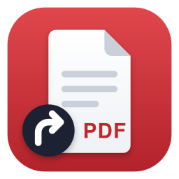

<p align="center">
  
</p>

<h1 align="center">Finder Shortcut for Zotero</h1>

<p align="center">
  Right-click an item in Zotero, then paste a shortcut to its PDF into any Finder folder.
</p>

<p align="center">
  
  
  
</p>

---

## What it does

Zotero keeps your PDFs in its own storage folder, which makes it hard to keep them next to your project files. **Finder Shortcut** adds one entry to the item right-click menu:

> **Copy Finder Shortcut**

It puts a **Finder alias** to each selected item's PDF on the clipboard. Press **⌘V** in any Finder folder and the aliases appear, named like:

```
Smith - 2021 - Title of the paper
```

Double-clicking an alias opens the PDF in your default PDF app (Preview, for example). Zotero doesn't need to be running.

## Features

- **One click.** The entry sits directly in the item right-click menu, not in a submenu.
- **Several items at once.** Select several items and all their shortcuts are copied together.
- **Survives renaming.** A Finder alias follows its file, so the shortcut keeps working when Zotero renames or moves the attachment after a metadata change.
- **Reusable.** Paste the same shortcuts into as many folders as you like.
- **Clear feedback.** A short notification confirms how many shortcuts were copied and lists any item without a local file.
- **English and French.** Follows Zotero's language.

## Requirements

- **macOS.** The plugin uses macOS aliases and the macOS clipboard.
- **Zotero 8 or later.** Built for Zotero 10 and marked as compatible up to Zotero 12.

## Installation

1. Download `finder-shortcut.xpi` from the [latest release](../../releases/latest).
2. In Zotero, open **Tools → Plugins**.
3. Click the gear icon and choose **Install Plugin From File…**, then select the `.xpi` file.

> In Firefox-based browsers, right-click the download link and choose *Save Link As…*, otherwise the browser may try to install the file itself.

## Usage

1. Select one or more items in Zotero. You can select the parent item or a specific attachment.
2. Right-click and choose **Copy Finder Shortcut**.
3. Open a Finder folder and press **⌘V**.

### Which file is used?

- **Parent item selected:** the plugin uses the attachment Zotero considers best, usually the main PDF.
- **Attachment selected:** the plugin uses that exact file. Use this when an item has several attachments.
- **No local file** (for example, a file not yet downloaded from sync): the item is skipped and listed in the notification.

### Good to know

- **Annotations.** The PDF opens outside Zotero, so annotations you make there are saved into the PDF file itself, not into Zotero's annotation layer. Use Zotero's reader when you want annotations stored in Zotero.
- **Clipboard.** Copying shortcuts replaces whatever was on your clipboard.

## How it works

When you choose **Copy Finder Shortcut**, the plugin:

1. Finds the file of each selected item.
2. Creates a Finder alias to it in a temporary folder, using macOS bookmark data (`NSURL`). This is the same format Finder uses for **Make Alias**.
3. Puts those aliases on the macOS clipboard (`NSPasteboard`), so Finder pastes them as files.

Steps 2 and 3 run through `osascript` (JavaScript for Automation), which comes with macOS. No extra software is needed.

## Building from source

The plugin is plain JavaScript with no build step. From the repository folder:

```bash
zip -r finder-shortcut.xpi manifest.json bootstrap.js content locale
```

### Repository layout

```
manifest.json            Plugin metadata (ID, version, Zotero compatibility, icons)
bootstrap.js             Menu registration and the copy logic
content/icons/           Plugin icon (PNG/SVG) and menu icon (SVG)
locale/en-US, fr-FR/     Menu labels
updates.json             Update manifest read by Zotero for automatic updates
docs/                    Images used in this README
```

## Publishing a new version

Zotero checks `updates.json` (the `update_url` in `manifest.json`) to offer updates automatically.

1. Raise `version` in `manifest.json`.
2. Build `finder-shortcut.xpi`.
3. Create a GitHub release tagged `vX.Y.Z` and attach the `.xpi`.
4. In `updates.json`, update `version` and `update_link` to point to that release's `.xpi`, then commit.

Zotero releases a new major version every few weeks. When a new version comes out, raise `strict_max_version` in both `manifest.json` and `updates.json` once you have checked the plugin still works.

## Troubleshooting

- **The menu entry doesn't appear.** Check that the plugin is enabled in **Tools → Plugins**, then restart Zotero.
- **Pasting in Finder gives a text clipping.** The copy didn't happen. Open **Tools → Developer → Error Console** and look for errors mentioning *Finder Shortcut*.
- **An item is listed as "No file".** The PDF isn't stored locally. Open it once in Zotero to download it, then try again.

Please report other problems in [Issues](../../issues).

## License

[MIT](LICENSE) © 2026 Nicolas Pasquier
